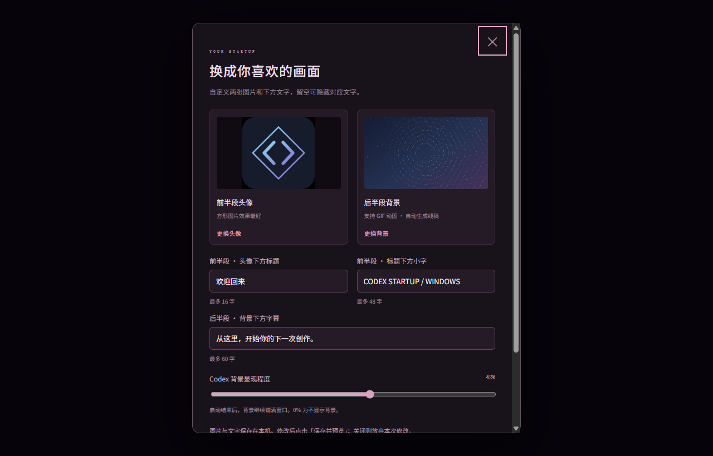

# Codex Startup Windows

为 Windows Codex 加上可自定义的启动动画和透明背景。双击一个安装 EXE，即可创建启动、图片设置和卸载入口。

基于 [M1ddle0/codex-startup-animation](https://github.com/M1ddle0/codex-startup-animation) 改编。动画在本机官方 Codex 窗口中播放，本项目是非官方外部启动器。


## 一键使用

1. 先安装 Microsoft Store / MSIX 版官方 Codex，保存工作并在菜单或托盘中**彻底退出**。
2. 双击 `CodexStartupWindows-Setup-1.0.0.exe`，安装自动完成，无需管理员权限。
3. 点击“启动并选择图片”，更换头像、背景和文字，点击“保存并预览”。
4. 以后从桌面 **Codex Startup Windows** 启动，或从 **Codex Startup Windows 设置** 更换画面。

完整操作见 [使用说明](docs/windows.md)，遇到问题可查看 [常见问题](docs/faq.md)。源码仓库发布后，可将安装 EXE、便携 ZIP 和 SHA256 校验文件作为 GitHub Release 附件。

## 你可以更换什么

| 设置 | 支持内容 |
| --- | --- |
| 前半段头像 | PNG、JPEG、WebP，自动居中裁切 |
| 后半段背景 | PNG、JPEG、WebP、GIF，自动在本机生成线稿 |
| 欢迎标题 | 最多 16 字，留空可隐藏 |
| 标题下方小字 | 最多 48 字 |
| 背景字幕 | 最多 60 字 |
| 背景显现程度 | 0–75%，0 可关闭背景 |

单张图片上限 30 MB。GIF 保留原始动画，启动结束后可继续作为动态背景。线稿取其中一帧，图片和线稿共享 3:2 裁切平面。



`Ctrl+Alt+B` 打开设置，Esc 或点击跳过启动动画。恢复默认与恢复原界面均可在设置中操作。图片和文字只保存在本机。

## 安装、更新与卸载

- 安装到 `%LOCALAPPDATA%\CodexStartupWindows\app`，创建当前用户的桌面和开始菜单入口。
- 更新直接运行新版安装器。文件替换失败时回滚，不覆盖安装目录中的无关文件。
- Windows“已安装的应用”中可以卸载。卸载只删除本项目拥有的文件和仍指向本项目的快捷方式。
- 更新、卸载保留已保存图片与文字。个人版素材和其他启动器使用独立设置空间。
- 也提供便携 ZIP，解压后保留整个文件夹，运行 `CodexStartup.exe`；运行 `CodexStartup.exe --settings` 打开设置。

## 运行要求与边界

面向 Windows 10/11 x64、Microsoft Store / MSIX 版官方 Codex。复用官方程序附带的 Node，不需要用户额外安装 Node、Python 或 Electron。ARM64、其他安装渠道与其他系统未实机验证。

启动器使用 MSIX 激活接口保留官方包身份，再连接随机 `127.0.0.1` 调试端口。连接前校验官方签名、程序路径、用户、父子进程关系及包身份。没有常驻服务，不修改官方安装文件。

调试端口随 Codex 进程保留，同机进程可访问调试接口。完全退出后从官方图标打开，会恢复普通运行。应用已经从普通入口运行时，需要完全退出后才能接入动画；项目不会强制结束用户工作。

安装器目前未签名，Windows 可能显示未知发布者。发布包附有 `SHA256SUMS.txt`。官方应用升级会重新发现安装路径，但后续版本的界面和接入协议仍可能变化。

## 从源码构建

在 Windows PowerShell 中进入项目根目录：

```powershell
powershell -NoProfile -ExecutionPolicy Bypass -File tools\build-release.ps1
```

使用系统 .NET Framework C# 编译器，输出到 `release/`：

```text
CodexStartupWindows-Setup-1.0.0.exe
CodexStartupWindows-Portable-1.0.0.zip
release-manifest.json
SHA256SUMS.txt
使用说明.md
```

默认图片、轮廓和 ICO 已包含在源码中，构建不需要下载素材或 npm 依赖。

开发自动化检查需要 Node 22+：

```powershell
node --test tools/*.test.mjs
powershell -NoProfile -ExecutionPolicy Bypass -File tools\test-installer.ps1
powershell -NoProfile -ExecutionPolicy Bypass -File tools\test-installer-integration.ps1 -Installer release\CodexStartupWindows-Setup-1.0.0.exe
```

安装器测试使用临时目录、独立的测试快捷方式目录和 HKCU 测试键，不安装到开发者的真实桌面或卸载列表。真实 Codex 窗口测试单独运行，详情见 [验证与开发说明](docs/development.md)。

## 项目结构

```text
animation.js / style.css       12 秒动画、线稿、设置界面
image-settings.js             图片导入、GIF 保存、IndexedDB、轮廓提取
assets/                       通用几何默认素材与图标
extension/                    运行时注入、背景样式、CDP 客户端与校验
windows/                      MSIX 激活、启动入口、安装/更新/卸载
tools/                        构建与测试
docs/                         使用、验证、来源说明
.github/workflows/            Windows 构建与测试
```

项目尚未发布到 GitHub。本地源码已整理为独立 Git 仓库，可推送到你选择的新仓库；本机个人启动包保持独立。

## 来源与授权说明

保留上游来源与修改说明，见 [references.md](docs/references.md)。所读取的上游版本未附明确 LICENSE，本项目不把继承的上游代码标记为未经确认的开放许可。通用默认素材以几何图形绘制，不打包个人图片、动漫素材或 OpenAI 官方图标。
